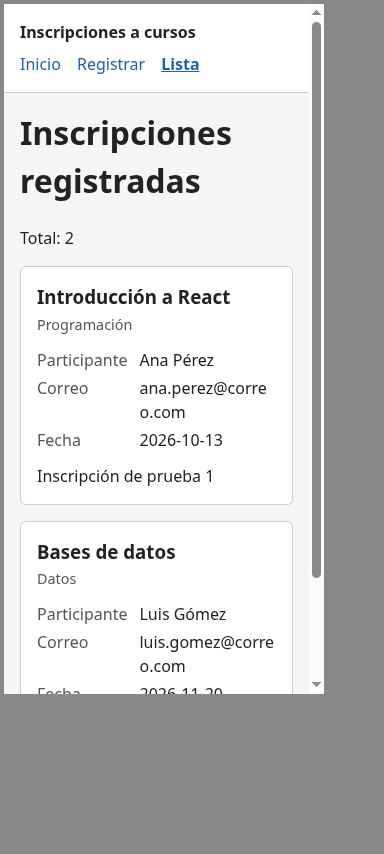
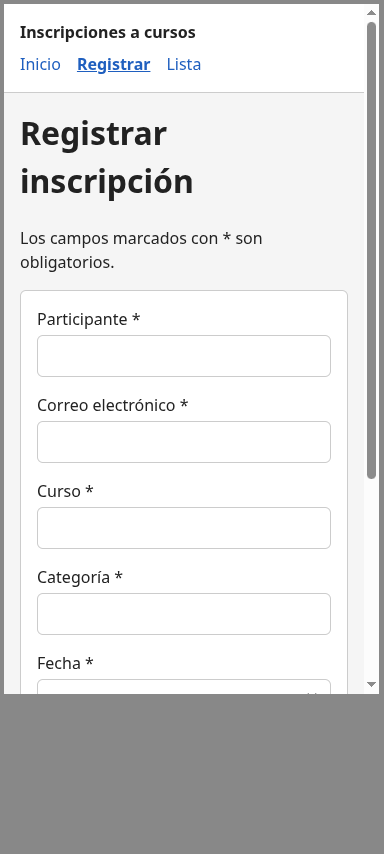
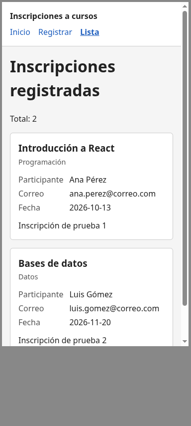

# Revisión en móvil

Responsable: Josué. Se revisaron `/`, `/registro` y `/lista` en Chrome a 375 px y 320 px de ancho.

## Resultado

| Página | 375 px | 320 px |
|---|---|---|
| `/` | Sin problemas | Sin problemas |
| `/registro` | Sin problemas | Sin problemas |
| `/lista` | Sin problemas | Correo cortado (problema 1) |
| Menú | Enlaces pequeños (problema 2) | Igual |

No hay desborde horizontal en ningún ancho. El menú se apila, los campos y botones ocupan todo el
ancho y las tarjetas se muestran en una columna.

## Problemas encontrados

**1. El correo se corta a mitad de palabra** (`/lista`, 320 px y también en escritorio). Por
ejemplo `ana.perez@corre` / `o.com`. Lo causa `overflow-wrap: anywhere` en `.tarjeta`
(`estilos.css`). Gravedad baja: no se pierde información.

**2. Los enlaces del menú son pequeños para tocarlos** (todas las páginas). Miden 24 px de alto y
se recomienda al menos 44 × 44 px en pantallas táctiles. Gravedad baja: se puede usar, pero es
incómodo.

## Capturas a 375 px

| Inicio | Registro | Lista |
|---|---|---|
|  |  |  |
