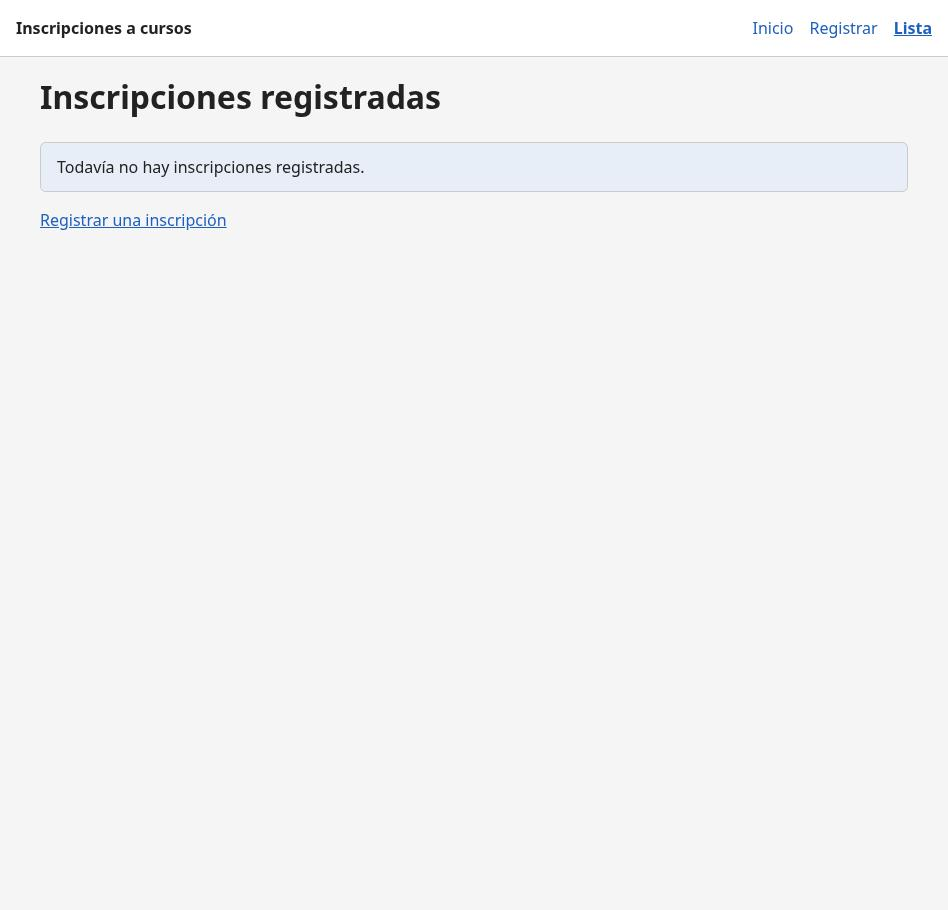
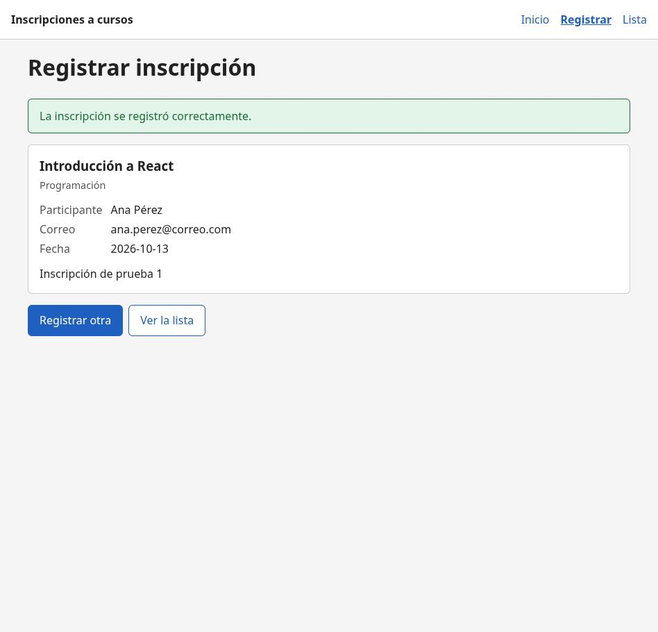
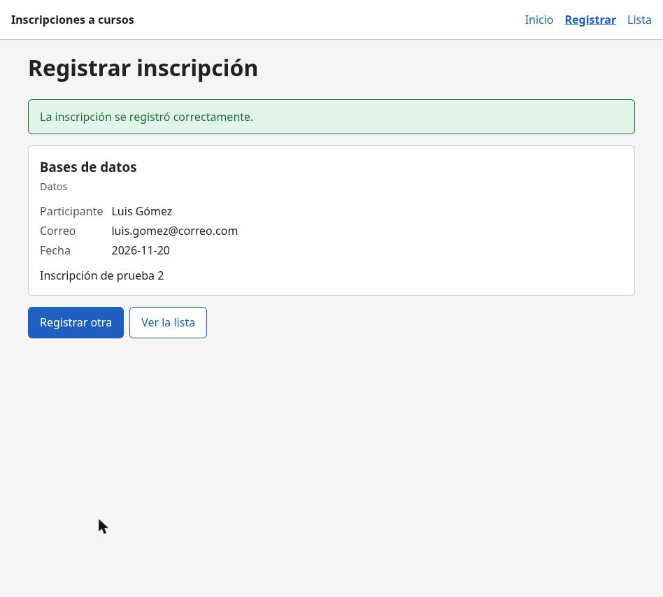
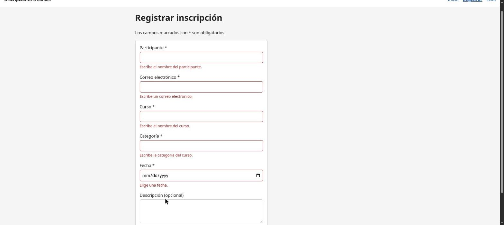
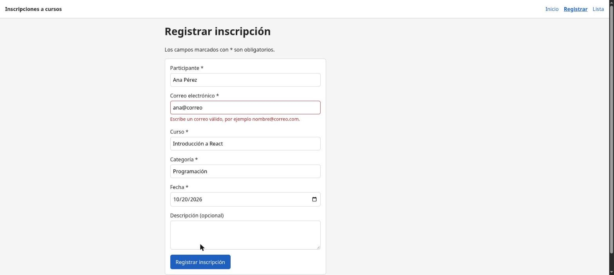
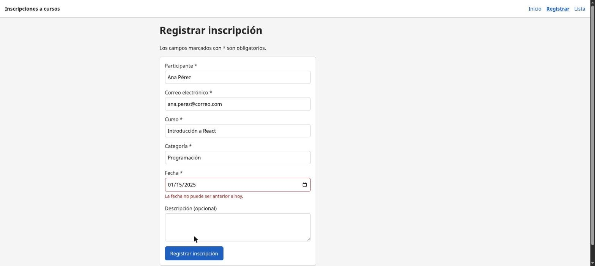
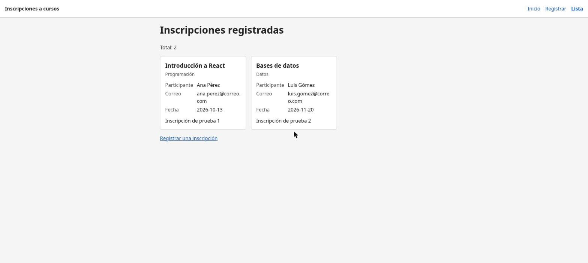
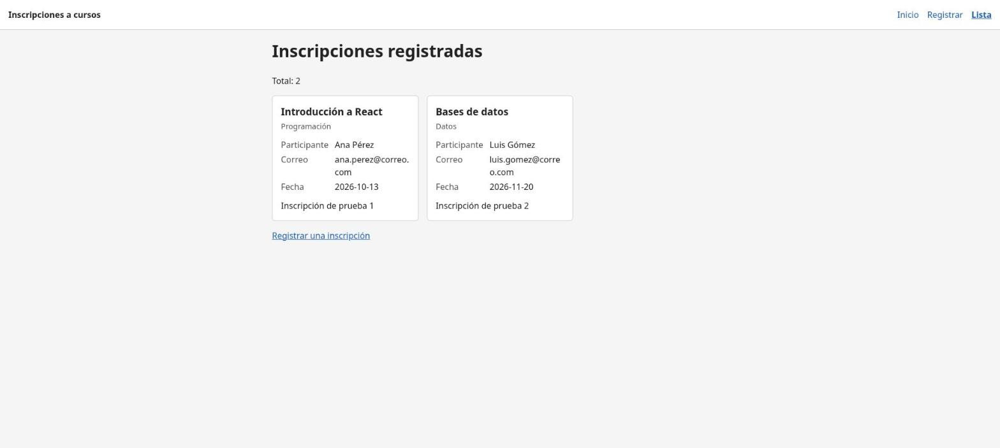

# Pruebas funcionales

Responsable: Josué. Backend en <http://localhost:3001> y frontend en <http://localhost:5173>.

## Resumen

| Prueba | Resultado esperado | ¿Pasó? |
|---|---|---|
| Lista vacía | Mensaje de que no hay inscripciones | Sí |
| Registro válido | Se guarda y muestra confirmación | Sí |
| Inscripción adicional | Se conserva la anterior | Sí |
| Formulario vacío | Mensajes de validación, no se envía | Sí |
| Email inválido | Se rechaza y explica el error | Sí |
| Fecha pasada | Se rechaza y explica el error | Sí |
| Datos inválidos directo a la API | Responde 400 | Sí |
| Consulta en la lista | Muestra los registros guardados | Sí |
| Reiniciar backend | Los registros siguen disponibles | Sí |

## 1. Lista vacía

Con `inscripciones.json` en `[]`, `/lista` muestra "Todavía no hay inscripciones registradas." y
un enlace para registrar una.



## 2. Registro válido e inscripción adicional

Se registraron dos inscripciones desde `/registro` (Ana Pérez y Luis Gómez). En ambas aparece
"La inscripción se registró correctamente." con la tarjeta guardada. `inscripciones.json` quedó con
las dos, cada una con un `id` UUID generado por el servidor; la primera no se borró.





## 3. Datos inválidos

En ningún caso se guardó nada: `inscripciones.json` siguió con 2 registros.

**Formulario vacío:** aparece un mensaje bajo cada uno de los 5 campos obligatorios y no se hace
la petición.



**Email inválido:** `ana@correo` se rechaza con "Escribe un correo válido, por ejemplo
nombre@correo.com."



**Fecha pasada:** `2025-01-15` se rechaza con "La fecha no puede ser anterior a hoy."



**Directo a la API**, sin pasar por el formulario:

```bash
curl -i -X POST http://localhost:3001/registros \
  -H "Content-Type: application/json" \
  -d '{"participante":"","email":"malo","curso":"","fecha":"2020-01-01","categoria":""}'
```

Responde `400 Bad Request` con 5 errores (participante, curso y categoría obligatorios, correo
inválido y fecha pasada). El servidor valida aunque alguien se salte el formulario.

## 4. Consulta en la lista

`/lista` muestra "Total: 2" y una tarjeta por inscripción con curso, categoría, participante,
correo, fecha y descripción. Los enlaces del menú y de cada página llevan a `/`, `/registro` y
`/lista` correctamente.



## 5. Persistencia tras reiniciar el backend

1. Se detuvo el backend con Ctrl + C. `/lista` muestra "No se pudo conectar con el servidor." y el
   botón "Reintentar", sin romperse.
2. Se inició de nuevo con `npm start` y se recargó `/lista`.
3. Aparecen las mismas 2 inscripciones con los mismos IDs, porque `almacen.js` las guarda en
   `backend/inscripciones.json` y las lee de ahí en cada consulta.


